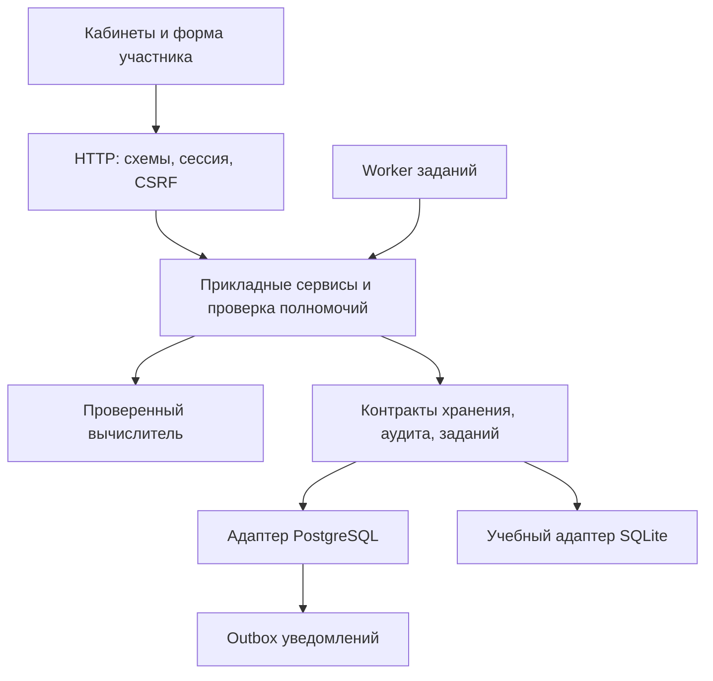

# Фаза 2 — проект архитектуры рабочей платформы

Дата: 2026-10-03. Основание: ROADMAP, принятый TKI-пилот main@a2724ea1 и прямые ответы владельца в этой сессии. Это проект следующей реализации. Новый сервер, PostgreSQL, расширенные права и рабочее размещение еще не созданы. Передача — PHASE2_HANDOFF.md; проверки — SECURITY_AND_DEPENDENCIES.md.

## 1. Принятые решения и ответственность

| Решение | Статус и граница |
|---|---|
| Единое приложение JS/TypeScript + PostgreSQL | Прямо принято владельцем. Проверенный JS-вычислитель сохраняется; библиотеки и внутренние технические решения поручены разработчику |
| Россия, Selectel | Прямо выбран будущий провайдер и страна. Аккаунт, тариф, ресурсы, точный регион, домен и публикация еще не создавались |
| ООО «ВайбМайнд» | По описанию владельца: код и техническое администрирование. Роль в договоре обработки данных требует оформления |
| ИП Тюлин | По описанию владельца: данные и исследования. Предполагаемый оператор исследовательских данных; полные реквизиты и юридическое распределение ответственности еще не установлены |
| Администратор | Все исследования: просмотр/скачивание первичных ответов и индивидуальных результатов; управление исследователями |
| Суперадминистратор | Те же права, методики, помощь исследователю в обработке, сигналы о нестандартных случаях, ручное управление процессами и контроль автоматических заданий |
| Доступы | Обе административные роли приглашают/блокируют исследователей; только суперадминистратор назначает административные роли. Для административного входа обязательна MFA; email участника необязателен |
| Исследовательские агрегаты | Не менее 10 участников; дополнительно защита от раскрытия через фильтры/разности |
| Сигналы | Кабинет + email суперадминистратору; в письме нет ответов, баллов, паспортных полей или сведений об участнике |
| Автономность после смены модели | Разрешены небольшие технические PR и merge после успешных автоматических проверок в пределах этих решений. Новые права, методики, платные сервисы и публикация согласуются отдельно |
| Граница текущей сессии | Подготовить проект, проверки и передачу; затем остановиться для смены модели |

Организационная принадлежность не выдает роль платформы всем сотрудникам компании. Доступ имеет конкретный приглашенный пользователь с подтвержденными полномочиями. Названия организаций здесь отражают ответы владельца, а не готовый договор или заключение о соблюдении законодательства.

## 2. Техническая основа

Модульный монолит: один репозиторий, один версионируемый серверный выпуск, PostgreSQL, отдельные процессы API и фонового worker при необходимости. Очередь первого контура — таблицы заданий/outbox PostgreSQL. Масштабирование начинается с измерений, а не дополнительных сервисов.

Технический выбор в делегированных владельцем пределах: Node.js 24 LTS, TypeScript для новых application/API/adapter модулей, Fastify для HTTP и схем ввода/вывода, `pg` для параметризованного SQL. Точные поддерживаемые patch-версии фиксируются lockfile в задаче 02в после проверки advisories/лицензий. ORM на первом переносе не требуется: критические CAS, составные FK и транзакции явно видны в SQL. PostgreSQL major выбирается из поддерживаемых в выбранном регионе Selectel и фиксируется одновременно в локальном контейнере, CI и будущем размещении.

Форма участника и ее модели сохраняются на текущем HTML/JS; обязательное правило — одна пара/вопрос на слайде. UI кабинетов развивается отдельными задачами фазы 3. Проверенный `core/tki-contract.js` и `Processor.scoreComplete` остаются JS-модулем с типизированной оболочкой, без изменения математики. SQLite сохраняется как учебный адаптер/эталон до доказанной совместимости нового контура.

Альтернативы рассмотрены: сохранение SQLite как единственной рабочей БД не соответствует выбранной платформенной основе; перенос вычислителя на Python создает необязательный риск расхождений; микросервисы и отдельный брокер пока не оправданы нагрузкой. Это технические решения для текущего масштаба, пересмотр оформляется ADR с измерениями.

Основания выбора версий: [Node.js LTS](https://nodejs.org/en/about/previous-releases), [поддержка Fastify](https://fastify.dev/docs/latest/Reference/LTS/), [транзакции node-postgres](https://node-postgres.com/features/transactions), [PostgreSQL в Selectel](https://docs.selectel.ru/managed-databases/postgresql/). Проверено 2026-10-03; поддерживаемость повторно проверяется перед установкой.

## 3. Границы модулей

| Модуль | Отвечает за | Не получает автоматически |
|---|---|---|
| Identity/access | Учетные записи, сессии, MFA, приглашения, отзыв, роль и область | Доступ к диагностике только из-за успешного входа |
| Research | Исследования, квоты, группы, динамические этапы, назначения | Изменение ключей/выпусков, первичные ответы исследователю |
| Instruments | Форма, ключ, обработчик, научная проверка, неизменяемый выпуск | Выполнение произвольного кода из редактора или текста методики |
| Participation | Паспорт/согласия, участие по этапам, собственный черновик и завершение | Изменение completed или чужой попытки |
| Scoring | Закрепленный обработчик и происхождение расчета | HTTP, БД, email, учетные записи, клиентские баллы |
| Analysis | Кнопка исследователя «Рассчитать», разрешенные агрегаты и качество | Выдача индивидуальных баллов через фильтр или выгрузку |
| Support/processes | Задания, сбои, сигналы, ручные действия суперадмина | Произвольный SQL, обход прав, изменение исходных ответов |
| Notifications | Доставка событий из outbox, повторы и дедупликация | Ответы/результаты в письмах, автоматическая регистрация внешнего сервиса |
| Audit | Кто, когда, зачем, над каким ресурсом действовал и чем завершилось | Пароли, токены, ответы, полные запросы и контактные значения в журнале |

Направление зависимости: HTTP/worker → application → ports и core; адаптер реализует ports. Core не импортирует web/storage. Хранение не импортирует HTTP. Прямой вызов БД из интерфейса отсутствует. Текущее смешение сервисов и SQL в storage/* переносится постепенно с контрактными тестами; подготовка не реорганизует эти файлы.

## 4. Целевая матрица доступа

«Свои» устанавливается сервером по сессии и текущему назначению. Разрешение политики и наличие реализованного endpoint — разные статусы. Новые строки реализуются отдельными задачами; существующий runtime в этом PR не расширен.

| Операция | Участник | Исследователь | Администратор | Суперадминистратор |
|---|---|---|---|---|
| Свой черновик, завершение, разрешенный результат | Свое доступное назначение | Нет от имени участника | Нет от имени участника | Нет от имени участника |
| Первичные ответы других | Нет | Нет | Просмотр/скачивание всех, аудит | Просмотр/скачивание всех, аудит |
| Индивидуальные результаты других | Нет | Нет | Просмотр/скачивание всех, аудит | Просмотр/скачивание и обработка через версионируемые операции |
| Исследования/группы/этапы/назначения | Чтение своих назначений | Управление своими исследованиями | Глобальный просмотр/контроль | Глобальный просмотр/контроль |
| Групповые расчеты | Нет | Свои исследования, разрешенные агрегаты, N≥10 | Просмотр/скачивание разрешенных результатов | Просмотр, помощь с расчетами и качеством |
| Пригласить/заблокировать исследователя, его квота | Нет | Нет | Да | Да |
| Назначить административную роль | Нет | Нет | Нет | Да, MFA и аудит; защищен последний активный суперадмин |
| Форма/ключ/шкалы/обработчик/публикация выпуска | Нет | Выбор утвержденного выпуска | Нет | Управление версиями и проверкой; новый обработчик проходит кодовую приемку |
| Пауза/возобновление/повтор задания, разбор сбоя | Нет | Запрос помощи и статус своего запроса | Просмотр состояния | Да, причина и аудит |
| Изменить исходные completed ответы или старый результат | Нет | Нет | Нет | Нет; допустим новый производный расчет с историей |
| Отключить аудит, выдать себе роль, обойти порог 10 для исследователя | Нет | Нет | Нет | Нет |

Обычный пользователь без подтвержденной роли получает только свой аккаунт. Контакты исследователей доступны менеджерам для управления их доступом. Участник заполняет собственный паспорт; исследователь получает только разрешенный групповой профиль. Детальная выдача контактов/паспортных полей участника административным ролям требует отдельного перечня целей/полей; глобальный просмотр диагностических протоколов не превращает все таблицы в открытый API.

Полномочия — централизованные именованные действия плюс область, статус ресурса и цель. Изменение/блокировка учетной записи отзывает сессии; роль из body/header/cookie-label не принимается. Административная MFA проверяется также для чувствительных операций. Нет режима «войти как участник». Исследовательские/participant/staff сессии имеют явное назначение, подмена области не повышает права.

## 5. Автоматические процессы и ручная помощь

«Автопилот» в этом проекте — серверные задания с определенными типами и правилами. Внешняя AI-служба, передача ей протоколов и произвольные исполняемые инструкции этим решением не вводятся.

Задание имеет тип, область исследования, закрепленные входы/версии, idempotency_key, состояние, попытки, ограниченный lease, инициатора и ссылки на журнал. Состояния: queued → running → succeeded / failed / needs_review; paused и cancelled не объявляются успешными. Повтор не дублирует результат/выгрузку/письмо. Пауза или отмена наблюдается на безопасной границе транзакции; завершенная операция не откатывается скрыто.

Сигналы суперадмину: повторный сбой задания, несовместимые версии, нарушение контрольного расчета, неполные/недопустимые данные, нестандартный запрос исследователя, отказ по политике выдачи. Необычный допустимый показатель помечается для проверки, не удаляется автоматически и не объявляется диагнозом. Один инцидент объединяет повторные сигналы; состояния open/acknowledged/in_progress/resolved и история действий.

Суперадмин может изучить данные в своей подтвержденной области, приостановить/возобновить задание, повторить безопасную операцию, выбрать документированный вариант аналитической обработки, запустить новый расчет и объяснить исследователю разрешенный итог. Для пересчета: новый processing_run, исходный snapshot/digest, точная версия обработчика, причина, actor, время; прежние ответы/результат сохраняются. Нет silent overwrite или произвольной правки балла. Исследователю по-прежнему выдаются только допустимые агрегаты. Новая научная методика/нормы или специальная выдача индивидуальных данных не становятся техническим исключением.

Email отправляется из transactional outbox после commit: нейтральное сообщение «В МетодТест требуется ваше внимание» и ссылка на обычный вход в кабинет. Нет ФИО, кодов участника, названий чувствительных кейсов, ответов, результатов, одноразовых сессионных ссылок. Получатель — утвержденный адрес суперадмина; смена адреса подтверждается. Провайдер доставки/договор/оплата выбираются отдельно перед включением реальной отправки. В тестах используется локальный приемник писем.

## 6. Контракты и PostgreSQL

Контекст доступа создается из проверенной сессии: actor_id, realm, role, разрешенная область, session_version. Он не десериализуется из клиентского запроса. Входные DTO используют устойчивые ID, версии и expected_revision. Ответные DTO задаются разрешенным списком полей; запись БД не сериализуется целиком. Клиентские баллы, роли и версии закрепленного выпуска отклоняются.

Порты прикладного слоя (асинхронные): `UnitOfWork.run(context, callback)`, `AttemptRepository.getAuthorized/compareAndSave`, `ReleaseRepository.getPinned`, `ResultRepository.getExisting/insertOnce`, `AuditRepository.appendRequired`, `OutboxRepository.enqueueOnce`. Callback одной транзакции получает один DB client; запрещено смешивать его с независимыми pool.query. Контракт `scoreTki` остается существующим; слой портов преобразует только транспорт/хранение.

Проверяемые инварианты переноса:

- Составные FK по study/group/stage/release, уникальность назначения и попытки, существование вопроса и допустимость A/B. UUID сохраняются; даты — timestamptz/UTC, JSON snapshot/result — jsonb. Канонизация digest остается существующей, не хэшом строкового представления jsonb.
- Сохранение проверяет текущие права и draft/revision в одной транзакции; только один конкурентный снимок выигрывает. Завершение записывает result/completed/revision/audit атомарно; повтор возвращает прежний результат. Полное отсутствие ответа не заменяется нулем.
- Блокировки: фиксированный порядок scope/actor → study/enrollment/assignment → attempt. Изменения полномочий используют совместимый порядок; обязательны гонки revoke/save и close/complete. Транзакции короткие, с timeout; email/внешний HTTP вне них. Дорогая будущая обработка получает snapshot и перед commit повторно проверяет версии/права.
- Runtime DB role не владелец таблиц и не superuser/BYPASSRLS. Мигратор использует отдельную роль. RLS для исследовательских/участнических строк — дополнительный барьер с тестами под реальной runtime ролью, в том числе для глобального административного чтения. Контекст соединения устанавливается transaction-local, извлекается из доверенной серверной сессии и не протекает следующему пользователю пула.
- Индексы по составным FK и основным запросам study/participant/status; планы проверяются на синтетических объемах. Пул соединений ограничен для API и worker, запас остается для мигратора/обслуживания; лимиты выбираются по нагрузочному прогону, не копируются из примера.

Переход: копия учебного снимка → отдельная временная PostgreSQL → миграции/импорт неизменяемого выпуска → сравнение записей/digest/результатов → контрактные тесты обоих адаптеров → HTTP/e2e → восстановление backup → приемка. Миграции SQLite 001–003 не меняются. Тестовые credentials создаются заново; активные сессии не переносятся. При неудаче исходная SQLite остается рабочим учебным контуром; обратной молчаливой синхронизации записей нет.

Новые модели следующего продукта: контактные данные отдельно от diagnostic participant; версии паспортной схемы/ответов и согласий; processing_runs; support_cases/events; jobs и notification_outbox. Они вводятся по задачам, а не одной большой миграцией. Уникальность человека между исследованиями не выводится по email без отдельного решения.

## 7. Агрегаты и данные

Порог 10 проверяется для фактического числа допустимых участников каждой выдаваемой шкалы/ячейки, после фильтров и пропусков; N по шкалам может различаться. Профиль паспорта следует тому же правилу. Первое исследовательское API допускает предопределенные группы/этапы/версии, без произвольных фильтров возраста/города и пересекающихся мелких подгрупп. Малые клетки и дополняющие их итоги подавляются совместно. Повторные срезы и изменения состава проверяются против восстановления одиночного вклада. Сам порог 10 не считается доказательством анонимности.

Email и связанные с человеком возраст, город, паспорт и диагностика проектируются как персональные данные. Контакты отделены от ответов внутренними ID; маскирование и ограничения действуют и в экспортах/логах/backup. Отсутствие ФИО не означает обезличивания. [Определение в статье 3 закона 152-ФЗ](https://mintrud.gov.ru/docs/laws/130) и [разъяснение прокуратуры о косвенной идентификации](https://epp.genproc.gov.ru/ru/proc_64/activity/legal-education/explain/e695991/). Это инженерная классификация для защиты данных; правовые основания и применимость требований к конкретной диагностике подтверждаются перед реальным набором.

Проект размещения: API/worker и PostgreSQL в выбранном российском регионе Selectel, БД в приватной сети, TLS до клиента и БД, ограниченные исходящие соединения, секреты вне репозитория. Контуры development/CI используют только синтетические данные. Реальные email/паспорта/протоколы и backup не передаются GitHub Actions, внешним AI-инструментам или в тестовые артефакты. Будущий deployment выполняется отдельным разрешенным процессом; CI проверок не имеет производственных ключей.

Backup и restore проверяются отдельно. У Selectel есть встроенные backup/PITR, но их наличие не доказывает достижение наших требований восстановления; срок/география/доступ и пробное восстановление входят в приемку ([документация](https://docs.selectel.ru/managed-databases/postgresql/backups/)). Конкретные RPO/RTO и срок хранения требуют эксплуатационного решения, тариф не выбран.

До реального запуска остаются: точные реквизиты и договорные роли ИП/ООО, перечень целей/данных/сроков, уведомления и основания обработки, отзыв/удаление/backup, решение о несовершеннолетних (ответ пока отсутствует), применимость специальных категорий к конкретным результатам, условия провайдера почты, инфраструктурный бюджет и разрешение публикации. Эти пункты не мешают реализации на синтетических данных и не считаются решенными самим выбором российского хостинга.

## 8. Приемка фазы 2

Фаза 2 считается реализованной после задач 02в–02з из BACKLOG: новые контракты/адаптер, проверенная PostgreSQL миграция, прежний TKI-сценарий через новый контур, сравнение результатов, отрицательные проверки доступа/конкурентности, проверка восстановления и успешный обязательный CI. Подготовка 02а–02б не закрывает эту приемку. Кабинеты менеджеров, редактор методик, аналитика и ручные процессы имеют согласованный проект, но реализуются в соответствующих следующих фазах ROADMAP.
